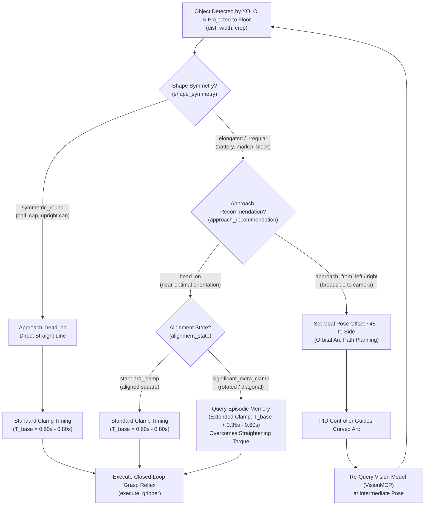

# CleanupBot - Autonomous Floor Retrieval Robot

**CleanupBot** is an autonomous mobile manipulator designed to locate, approach, clamp, and retrieve any small object on the floor that fits within its gripper (width $\le 4.5\text{ cm}$, payload under $100\text{g}$). It integrates closed-loop vision perception, episodic memory motor adaptation, differential drive control, and ROSA (Robot Operating System Agent) LLM orchestration.

---

## 1. Overview & Core Objective

### Core Objective
Locate, safely approach, grasp, and retrieve objects resting on an indoor floor that fit within the physical grasp aperture of the gripper:
- **Mass / Payload**: Under 100 grams.
- **Physical Grasp Constraint**: The parallel jaw gripper opens to a maximum aperture of $4.5\text{ cm}$ (e.g. bottle caps, small containers, AA/AAA batteries, wooden blocks, markers, small toys).
- **Scope**: Any small floor clutter within the $\le 4.5\text{ cm}$ grasp aperture.

### Mission Sequence
1. **Perception**: Scan the floor using open-vocabulary detection (YOLO-World via FastMCP) to identify target objects and classify their geometry (dimensions, shape symmetry, and horizontal orientation).
2. **Standoff Navigation**: Plan an approach trajectory (direct head-on or orbital curved arc) to navigate smoothly via PID differential drive to an optimal $40\text{ cm}$ standoff pose facing the object.
3. **Re-centering & Alignment**: Re-scan at $40\text{ cm}$ standoff to verify heading, measure target dimensions accurately, and determine whether the object rests square or rotated.
4. **Memory-Grounded Manipulation**:
   - Advance to the $16\text{ cm}$ grasp contact waypoint.
   - Tilt gripper downwards to the floor.
   - Query **ChromaDB Episodic Memory** to recall past clamp trials and adapt motor clamp duration ($0.60\text{s}$ baseline up to $1.20\text{s}$ extended clamp).
   - Perform pre-lift visual audit (`verify_grasp`).
   - Lift gripper arm and perform post-lift visual audit.
   - Persist outcome to episodic memory for continuous learning.

---

## 2. Hardware Inventory & Platform Assembly

### Platform Specifications
* **Chassis & Drive Base**: Clear acrylic chassis driven by a two-wheel differential drive setup with a passive rear caster wheel for 3-point balance.
  - Track Width (Wheelbase): $14.0\text{ cm}$.
  - Wheel Diameter: $6.6\text{ cm}$ (Radius: $3.3\text{ cm}$).
  - Ground Clearance: $4.4\text{ cm}$.
* **Drive Motors & Actuation**:
  - TT High-Torque 1:90 half-metal gearbox DC motors.
  - 12 PPR two-phase AB Hall effect encoders ($12 \times 90 \times 2 = 2160$ ticks per wheel revolution).
  - DRV8833 Dual H-Bridge motor driver with $470\mu\text{F}$ bulk VM capacitor.
  - Power: 6x AA battery pack ($7.5\text{V} - 9.0\text{V}$).
* **Manipulation Assembly**:
  - Front-mounted parallel gripper with continuous DC motor ($4.5\text{ cm}$ maximum span, $3.0\text{ cm}$ throat depth).
  - Dedicated DC tilt motor with hinge pin forward overhang ($8.0\text{ cm}$ ahead of drive axle, $7.0\text{ cm}$ above floor).
* **Sensors**:
  - **ESP32-S3-CAM**: Mounted directly on the tilting gripper arm so the optical axis tracks the gripper's view. Runs custom MicroPython firmware serving an MJPEG stream over Wi-Fi.
  - **BNO085 9-DOF IMU**: Mounted on the tilting gripper arm ($2.0\text{ cm}$ forward, $3.0\text{ cm}$ above tilt pin). Pitch/roll tracks arm tilt angle; yaw provides robot world heading.
  - **HC-SR04 Ultrasonic Sensors**: Front corner sensors angled at $\pm 45^\circ$. *(Note: De-emphasized/legacy hardware. Primary obstacle avoidance and navigation rely on the vision perception pipeline).*
* **Compute & Communication**:
  - **Raspberry Pi Pico 2 W**: Runs micro-ROS over Wi-Fi UDP, handling low-level motor PWM, encoder ticks, and IMU telemetry.
  - **Windows Host & WSL2**: Runs Ollama LLM, ROS 2 Jazzy, ROSA orchestration agent, OpenCV GUI HUD, and FastMCP servers. Communicates with Pico 2 W via high-performance UDP relay script (`relay.py`).

---

## 3. Engineering Considerations & Technical Nuances

### 1. Open-Loop Continuous Gripper Motors & Episodic Memory
The parallel gripper and tilt mechanisms are powered by continuous DC motors without internal potentiometers or encoders. Consequently, arm elevation and claw clamping cannot be commanded to an absolute degree or millimeter position. Instead:
- Clamp travel is controlled via **motor run duration** (in seconds).
- Rather than relying on hardcoded timings, the robot uses **Episodic Memory (MemoryMCP with ChromaDB)**. When presented with an object, the agent queries past episodes matching the object's width, shape, and orientation (`is_diagonal`) to retrieve the optimal duration. If a trial slips, the duration is dynamically adapted ($0.60\text{s} \rightarrow 1.20\text{s}$) to overcome straightening torque.

### 2. Tilting Optical Geometry & Ground Plane Projection
Because the ESP32-S3 camera is attached to the tilting gripper arm:
- The camera's pitch relative to the floor varies with the arm's tilt.
- The vision pipeline (`VisionMCP/vision_core/geometry.py`) combines the BNO085 IMU pitch telemetry with optical camera calibration (`camera_calibration.json`) or kinematic nominals (`config.py`).
- Bounding box bottom-center pixel coordinates are raycast onto the floor plane $Z=0$, converting image pixel detections into exact metric Cartesian coordinates $(X_m, Y_m)$ in the robot's coordinate frame.

### 3. Ultrasonic Sensors Status
The HC-SR04 ultrasonic sensors have a wide $15^\circ$ acoustic cone and struggle with small objects ($< 3\text{ cm}$) scattered on reflective floors. As a design decision, ultrasonic readings are treated as secondary/legacy fallback; the primary navigation, hazard localization, and obstacle clearance pipeline is driven by vision perception and pose tracking.

---

## 4. Perception, Approach & Grasping Decision Flow



### Breakdown of Decision Stages:
1. **Shape Symmetry & Profile Check**:
   - `symmetric_round`: Equal grasp width from all horizontal angles (e.g. ball, upright bottle cap). Approached head-on without orbiting.
   - `elongated` / `irregular`: Has distinct long and short axes (e.g. marker, AA battery). If oriented broadside, its cross-section may exceed the $4.5\text{ cm}$ jaw opening.
2. **Approach Vector**:
   - `head_on`: Heading is near-optimal.
   - `approach_from_left` / `approach_from_right`: Waypoint offset by $\sim 45^\circ$ to navigate along an orbital arc so the jaws grasp the narrow dimension.
3. **Alignment & Adaptive Grasping**:
   - `standard_clamp`: Object is aligned square with the jaws. Uses nominal clamp time $T_{\text{base}}$ ($0.60\text{s} - 0.80\text{s}$).
   - `significant_extra_clamp`: Object is diagonal ($20^\circ-70^\circ$). Parallel jaws exert asymmetric torque that twists the object, requiring extended motor travel ($1.00\text{s} - 1.20\text{s}$) retrieved from memory.
   - **Grasp Reflex (`execute_gripper`)**: Clamps $\rightarrow$ runs visual audit (`verify_grasp`) $\rightarrow$ in-place retry if loose $\rightarrow$ lifts arm $\rightarrow$ post-lift audit $\rightarrow$ persists outcome to ChromaDB.

---

## 5. Subsystems & Code Organization

```graphql
CleanupBot/
├── cleanupbot_agent.py         # Autonomous ROSA Agent (LangChain + Ollama + MCP)
├── cleanupbot_tools.py         # Local robot primitives (navigate_to_pose, execute_gripper, pose)
├── cleanupbot_gui.py           # Real-time OpenCV HUD visualizer (HUD banner, memory badge, detections)
├── config.py                   # Central source of truth (kinematics, topics, waypoints, PID gains)
├── robot_motion.py             # Differential drive controller with course safety limits
├── prompt_improvement.py       # Systematic prompt engineering & RobotSystemPrompts revisions
│
├── ros2_bridge/                # ROS 2 Python Client Abstraction Layer
│   ├── publisher.py            # RobotPublisher singleton (/cmd_vel, /gripper/command, /agent/status)
│   └── subscriber.py           # RobotSubscriber singleton (encoders, IMU, ultrasonic, camera)
│
├── esp32s3_cam/                # ESP32-S3 Camera System
│   ├── main.py                 # MicroPython MJPEG streaming server (reads .env)
│   ├── esp32_cam_node.py       # ROS 2 node publishing frames to /camera/image_raw
│   ├── .env.example            # Wi-Fi network credentials template
│   └── firmware/               # MicroPython camera binaries
│
├── VisionMCP/                  # FastMCP Vision Perception Server
│   ├── mcp_vision_server.py    # Tools: scan_for_hazards, verify_grasp
│   ├── pixi.toml               # Dedicated CUDA / PyTorch GPU environment
│   └── vision_core/            # Class-agnostic YOLO detector, geometry projection, color analyzer
│
├── MemoryMCP/                  # FastMCP Episodic Memory Server
│   ├── mcp_memory_server.py    # Tools: query_grasp_timing, record_grasp_episode, recall_facts
│   └── robot_memory_db/        # Persistent ChromaDB sqlite database
│
├── ros2_ws/                    # Gazebo Harmonic Simulation
│   └── src/robot_sim/          # Apartment world, obstacle course, URDF/Xacro, sim_bridge node
│
├── gazebo_car_agent.py & tools # Gazebo car simulation exploration subsystem
├── sim_to_real_agent.py & tools# Sim-to-real validation and comparison subsystem
│
└── tests/                      # Assertive Hardware Diagnostic & Calibration Suite
    ├── check_setup.py          # 5-link telemetry & assertive hardware check (--wheel-test)
    ├── calibrate_motors.py     # Stiction breakout duty & encoder tick calibration tool
    ├── test_mcp_client.py      # MCP client connectivity tests
    └── test_memory.py          # Memory retrieval persistence tests
```

---

## 6. Execution & Operation Guide

### Environment Setup
All dependencies run under the unified root Pixi environment from `src/`:
```bash
cd src
pixi install
```

### Hardware Deployment

#### 1. Raspberry Pi Pico 2 W Firmware
```bash
cd src/Robot/pico2w_led
pixi install
pixi run build
# Hold BOOTSEL on Pico 2 W, connect USB, and copy build/pico2w_led.uf2 to the drive
```

#### 2. ESP32-S3 Camera Setup
1. Copy `CleanupBot/esp32s3_cam/.env.example` to `CleanupBot/esp32s3_cam/.env` and enter your Wi-Fi credentials.
2. Upload `.env` and `main.py` via `mpremote`:
   ```powershell
   uvx mpremote connect COM7 cp CleanupBot\esp32s3_cam\.env :.env
   uvx mpremote connect COM7 cp CleanupBot\esp32s3_cam\main.py :main.py
   uvx mpremote connect COM7 reset
   ```

### Mission Execution Terminals

When running the physical robot over the Windows 2.4 GHz Mobile Hotspot:

| Terminal | Execution Command (from `src/`) | Description |
|---|---|---|
| **1. Relay (Windows)** | `python relay.py` | Multiplexes Pico UDP packets (port 8888) to WSL2 (port 8889). |
| **2. Micro-ROS Agent** | `pixi run micro-ros-agent` | Connects ROS 2 DDS to the Pico 2 W micro-ROS client. |
| **3. Camera Node** | `python CleanupBot/esp32s3_cam/esp32_cam_node.py` | Ingests ESP32 MJPEG stream and publishes to `/camera/image_raw`. |
| **4. GUI Monitor** | `python CleanupBot/cleanupbot_gui.py` | Launches the live OpenCV HUD displaying telemetry & detections. |
| **5. Autonomous Agent** | `python CleanupBot/cleanupbot_agent.py` | Starts the ROSA planning & tool orchestration agent. |

### Simulation Mode (Gazebo Harmonic)
To run the robot in simulation instead of real hardware:
```bash
# Build the simulation package
pixi run build-sim

# Launch Gazebo Harmonic apartment world
pixi run sim

# In a separate terminal, launch the autonomous agent
python CleanupBot/cleanupbot_agent.py
```

---

## 7. Hardware Diagnostics & Calibration Tests

Before initiating autonomous missions, verify all hardware links and motor trims:

```bash
# 1. Verify all 5 sensor & telemetry links (Gazebo + Real Robot IMU/Encoders):
python CleanupBot/tests/check_setup.py

# 2. Assertive wheel motion test (checks wiring polarity, stalls, motor switch):
python CleanupBot/tests/check_setup.py --wheel-test

# 3. Automated motor breakout duty stiction & left/right trim balance calibration:
python CleanupBot/tests/calibrate_motors.py
```
